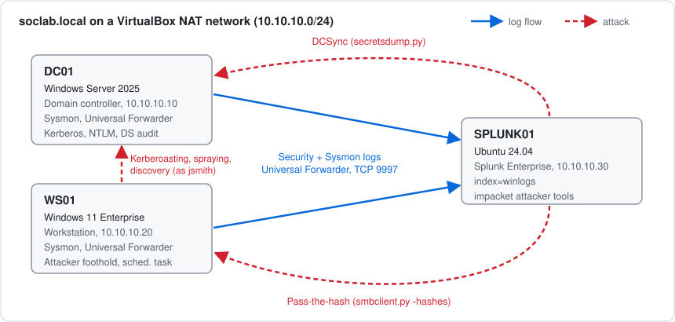
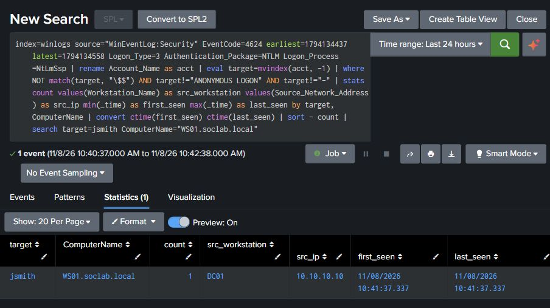

# Active Directory Attack & Detection Lab

I built a small Windows domain in VirtualBox, ran six MITRE ATT&CK techniques against it, and wrote a Splunk search for each one. Every search was tested against the logs its attack produced, and the captured results are in [`evidence/`](evidence/).

My [SOC monitoring lab](https://github.com/BharathwajM/soc-portfolio-lab) covers cloud detection in Microsoft Sentinel. This lab covers on-premises identity and endpoint logs in Splunk, which is where most AD attacks show up.

## Lab setup

| Host | OS | Role | IP |
|------|----|------|----|
| **DC01** | Windows Server 2025 | Domain controller for `soclab.local`, DNS, audit policy | 10.10.10.10 |
| **WS01** | Windows 11 Enterprise | Domain-joined workstation, the attacker's foothold | 10.10.10.20 |
| **SPLUNK01** | Ubuntu 24.04 | Splunk Enterprise, plus impacket as the Linux attacker | 10.10.10.30 |

All three VMs sit on an isolated VirtualBox NAT network (`10.10.10.0/24`).

- **Sysmon** runs on both Windows hosts with Olaf Hartong's [`sysmon-modular`](https://github.com/olafhartong/sysmon-modular) config.
- **Audit policy** on the DC records Kerberos service tickets (4769), directory access (4662), logons (4624/4625) and process creation with the command line (4688).
- **Splunk Universal Forwarder** on each Windows host sends the Security, System, Sysmon and PowerShell Operational logs to `index=winlogs` on SPLUNK01 (TCP 9997).

## Techniques run and detected

| # | Technique | ATT&CK ID | Run from | Event | What the search looks for |
|---|-----------|-----------|----------|-------|---------------------------|
| 1 | Kerberoasting | [T1558.003](https://attack.mitre.org/techniques/T1558/003/) | WS01 | 4769 | **RC4** service tickets (0x17) in an AES domain |
| 2 | Password spraying | [T1110.003](https://attack.mitre.org/techniques/T1110/003/) | WS01 | 4625 | One source failing against 5+ accounts in 10 minutes |
| 3 | DCSync | [T1003.006](https://attack.mitre.org/techniques/T1003/006/) | SPLUNK01 (impacket) | 4662 | Replication rights used by a **non-DC** account |
| 4 | Pass-the-hash | [T1550.002](https://attack.mitre.org/techniques/T1550/002/) | SPLUNK01 (impacket) | 4624 | Hunt: NTLM network logons. Tuned alert: the Administrator account over NTLM from an unexpected source |
| 5 | Scheduled task | [T1053.005](https://attack.mitre.org/techniques/T1053/005/) | WS01 | 4688 | `schtasks /create` or `Register-ScheduledTask` in the command line |
| 6 | Account discovery | [T1087.002](https://attack.mitre.org/techniques/T1087/002/) | WS01 | 4688 | Two or more different AD discovery commands from one user on one host |

The [walkthrough](docs/walkthrough.md) explains each attack, the event it left behind and why the search catches it. The SPL is in [`detections/`](detections/).

## Triage playbooks

Each alert has a [Tier 1 triage playbook](playbooks/): what the alert means, the checks to run, pivot searches, common benign causes, when to escalate, and what to record. The [playbook index](playbooks/README.md#how-the-alerts-connect) also puts the lab's alerts on one timeline. It shows that the user `jsmith` on WS01 and the Administrator account used from 10.10.10.30 link every alert, and that DCSync was already running against the DC before the first Kerberoasting request.

## Tuning the pass-the-hash alert

Event 4624 shows that a logon used NTLM, but not whether the client typed a password or replayed a stolen hash. So the broad NTLM search also matched normal logins. To measure that, I replayed three captured cases through the broad hunt and a tuned alert ([04b](detections/04b-unexpected-privileged-ntlm.spl)):

| Test case | Broad hunt | Tuned alert |
|---|---|---|
| Hash-only login as Administrator from SPLUNK01 (the attack) | Matched | **Matched** |
| Normal password login as jsmith from DC01 | Matched | Filtered |
| Approved Administrator login from DC01 | Matched | Filtered |

The tuned alert kept the attack and dropped both benign cases. Its limits are written up in the [tuning replay](docs/walkthrough.md#tuning-replay).

## Skills shown

- Writing and testing SPL detections against real attack telemetry, then tuning out false positives
- Reading AD security events: 4769 encryption types, 4662 replication GUIDs, NTLM logon details, 4688 command lines
- Writing triage playbooks and correlating separate alerts into one timeline
- Mapping detections to MITRE ATT&CK
- Building the lab from scripts: unattended VM installs, DC promotion, Sysmon and forwarder rollout

## Build it yourself

Everything is scripted. [`build/`](build/) creates the VMs, promotes the DC and deploys Sysmon and the forwarder. [`attacks/`](attacks/) runs the techniques. Lab passwords are read from a gitignored `lab-credentials.local.txt`, so no secrets are committed.

> Built on local VirtualBox VMs using evaluation editions of Windows Server 2025 and Windows 11 Enterprise. All attacks ran only inside this isolated lab network.

---

*Part of my security portfolio. See also: [SOC monitoring lab (Sentinel)](https://github.com/BharathwajM/soc-portfolio-lab) · [Phishing triage tool (Python)](https://github.com/BharathwajM/phishing-triage-automation) · [Essential Eight hardening lab (PowerShell)](https://github.com/BharathwajM/essential-eight-lab).*
