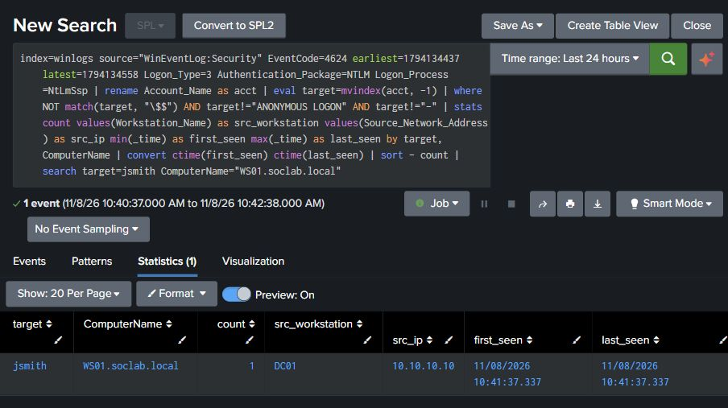

# Walkthrough: attack → telemetry → detection

For each technique: what was run, the event it produced, and the Splunk search that caught it.
Full search + captured results for every one are in [`../evidence/`](../evidence/).

---

## 1. Kerberoasting (T1558.003)
**Run (WS01, as domain user `jsmith`):** requested a Kerberos service ticket for the `MSSQLSvc/dc01` SPN via a pure-.NET `KerberosRequestorSecurityToken`. The target account `svc_sql` is pinned to RC4, modelling a legacy service account.
**Telemetry:** Security **4769** on DC01 with `Ticket_Encryption_Type=0x17` (RC4).
**Detection fired:** `jsmith` from `10.10.10.20` → 3 RC4 service-ticket requests for `svc_sql`.
**Why it works:** modern AD issues AES (`0x12`); an RC4 service ticket for a user account is the roasting tell.

## 2. Password Spraying (T1110.003)
**Run (WS01):** one wrong password tried across all ten domain users via `net use \\dc01\IPC$`.
**Telemetry:** Security **4625** (failed logon), many accounts from one source in a short window.
**Detection fired:** WS01 source → ≥5 distinct accounts failing in a 10-minute bucket.
**Why it works:** spraying is wide and shallow. One password across many accounts is the opposite pattern to brute force.

## 3. DCSync (T1003.006)
**Run (SPLUNK01, impacket):** `secretsdump.py -just-dc` replicated the directory and dumped every account hash (incl. `krbtgt`, domain `Administrator`).
**Telemetry:** Security **4662** on DC01 exercising the replication GUIDs (`1131f6aa…` / `1131f6ad…`).
**Detection fired:** `Administrator` → 102 replication accesses from a non-DC account.
**Why it works:** only domain-controller machine accounts legitimately replicate; a user doing it is DCSync.

## 4. Possible pass-the-hash (T1550.002)
**Run (SPLUNK01, impacket):** authenticated to WS01 over SMB using **only** the recovered `Administrator` NT hash (`smbclient.py -hashes`).
**Telemetry:** Security **4624** Logon Type 3, `Authentication_Package=NTLM`, `Logon_Process=NtLmSsp`.
**Detection fired:** `Administrator` arriving over NTLM network logon from the attacker host.
**Why it matched:** the known test used an NT hash, while the event records an NTLM network logon. The search also returned other NTLM activity on DC01. Event 4624 shows the authentication package and logon type without identifying whether the client supplied a password or reused a hash.

| Comparison | Event fields | What the search tells you |
|---|---|---|
| Captured hash-only SMB test | 4624, type 3, NTLM, `NtLmSsp`; `Administrator` on WS01 from SPLUNK01 | Matched. The test command establishes the hash-only method. |
| Captured benign password-based SMB test | 4624, type 3, NTLM, `NtLmSsp`; `jsmith` on WS01 from DC01 | Matched. The password prompt establishes the credential method for this test. |

### Benign comparison run

On DC01, a Command Prompt session opened an SMB connection to WS01 with the standard lab account `SOCLAB\jsmith`. The asterisk prompts for the password without placing it in the command line.

```cmd
net use \\10.10.10.20\IPC$ /user:SOCLAB\jsmith *
```

Splunk indexed WS01 Security Event **4624**, record **5240**, at **2026-11-08 10:41:37.337 UTC**. It showed logon type **3**, authentication package **NTLM**, logon process **NtLmSsp**, key length **128**, and source **DC01 (10.10.10.10)**.

The [existing SPL](../detections/04-pass-the-hash.spl) returned one match for `jsmith` on WS01 in the **10:40:37–10:42:38 UTC** window. The search below adds time bounds and filters the output to that account and host after aggregation.



Both captured cases match the broad hunt. During triage, check whether the account, source, destination and time fit approved activity. Correlate with SMB share or endpoint process activity if available before deciding whether to escalate.

### Tuning replay

A [narrower lab alert](../detections/04b-unexpected-privileged-ntlm.spl) looks for the lab Administrator account using NTLM on WS01 from a known source other than DC01. DC01 is the expected admin origin for this exercise. The existing hunt remains available for events outside that scope.

The approved-source control used the same privileged account as the hash-only test. From DC01, a session running as `SOCLAB\Administrator` opened WS01's `IPC$` share with its current credentials. `Get-SmbConnection` confirmed the Administrator session. WS01 recorded Security **4624** (type **3**, **NTLM**, **NtLmSsp**) for source **10.10.10.10** in records **15053** and **15055**.

Both searches used **2026-11-08, 07:26:00–11:16:00 UTC** (`earliest=1794122760 latest=1794136560`). The broad output was limited to WS01 and the two test accounts. It returned three events in the Administrator row and one in the jsmith row. The tuned alert returned only the hash-only test, with no output filter.

| Captured test | Event time (UTC) | Broad hunt | Tuned alert |
|---|---|---|---|
| Hash-only SMB, Administrator from SPLUNK01 (10.10.10.30) to WS01 | 07:27:28.445 | Matched | Matched |
| Password-based SMB, jsmith from DC01 (10.10.10.10) to WS01 | 10:41:37.337 | Matched | Filtered |
| Approved SMB, Administrator from DC01 (10.10.10.10) to WS01 | 11:14:12.881 and 11:14:43.233 | Matched both | Filtered both |

The approved Administrator control holds the account and destination constant across the privileged cases and validates the lab's expected-source filter. An attacker using DC01, another account, or a different destination could fall outside the tuned alert. For an enterprise deployment, use verified privileged-account and expected-source baselines for each destination.

## 5. Scheduled Task (T1053.005)
**Run (WS01, as `jsmith`):** `schtasks /create /tn ATOMIC-T1053 …`.
**Telemetry:** Security **4688** (process creation with command line) for `schtasks.exe /create`.
**Detection fired:** WS01 / `jsmith` created task `ATOMIC-T1053`.
**Why it works:** the command line captures the task name and the action it will run, which is a common persistence and execution signal.

## 6. Account Discovery (T1087.002)
**Run (WS01, as `jsmith`):** `net user /domain`, `net group "Domain Admins" /domain`, `net accounts /domain`, `nltest /dclist`.
**Telemetry:** Security **4688** for `net.exe` / `net1.exe` / `nltest.exe` with their command lines.
**Detection fired:** WS01 / `jsmith` → 10 distinct discovery commands in the same second.
**Why it works:** one lookup is normal admin work; a burst of distinct enumeration commands from one user is reconnaissance.

---

## Detection-engineering notes (what I had to tune)

Getting the detections to work on this lab's data took some fixing:

- **Sysmon as XML had no extracted fields.** With `renderXml=1` the forwarder shipped raw XML, so `CommandLine`/`Image` never extracted and the process-creation detections were blind. I moved the process-creation detections to **Security 4688 with command-line auditing** (reliable, no add-on) and switched the forwarder to the classic format.
- **The DCSync GUID isn't a clean field.** Splunk extracts `Properties` on 4662 as just `Control Access`; the replication GUID lives in the event body, matched with `TERM()`.
- **Kerberos is AES by default now.** A single RC4 service ticket is high-signal, so the detection keys on encryption type rather than a noisy SPN-fan-out threshold.
- **The emulation showed `Key_Length=128`.** The rule filters NTLM network logons and excludes machine and anonymous accounts. It does not filter key length or test whether the account is privileged.
